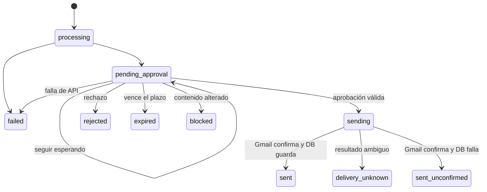

# Arquitectura y decisiones

## Problema del negocio

Las consultas comerciales suelen quedar repartidas entre formularios, planillas y correos. Preparar cada respuesta manualmente demora la atención y pierde contexto. El sistema centraliza ese recorrido y prepara respuestas que un responsable puede revisar.

La intervención humana se concentra en la aprobación de una propuesta. La recepción, búsqueda de contexto, redacción, espera, envío autorizado y registro se ejecutan automáticamente.

## Contrato de entrada

```json
{
  "event_id": "consulta-demo-0001",
  "name": "Cliente de demostración",
  "email": "cliente@example.com",
  "message": "Quiero conocer cómo funciona la predicción de alumnos.",
  "consent": true
}
```

`event_id` identifica el evento del origen. `consent` debe ser el booleano true. El email debe ser un único destinatario. El texto tiene entre 10 y 4000 caracteres. Los campos adicionales no se utilizan y nunca pueden alterar configuración, destinatarios internos ni aprobación.

## Recorrido de datos

| Etapa | Entrada | Salida |
|---|---|---|
| Recepción | Webhook con Header Auth | Datos normalizados o rechazo 400 |
| Duplicados | EventId | Solicitud previa o nuevo registro |
| Memoria | Email validado | Últimas respuestas enviadas al mismo cliente |
| Conocimiento | Documentos activos | Hasta cinco documentos seleccionados |
| IA | Consulta + historial + conocimiento | Objeto sujeto a JSON Schema |
| Validación | Respuesta de IA | Borrador válido o incidencia |
| HITL | Borrador guardado | Aprobación, rechazo, bloqueo o vencimiento |
| Salida | Borrador aprobado | Email y GmailMessageId |
| Auditoría | Cada resultado | Estado final o incidencia |

## IA y recuperación

El modelo recibe instrucciones de sistema separadas de los datos. La consulta y el historial no se consideran instrucciones. Se pide no inventar precios, descuentos, resultados ni asociaciones comerciales. El destinatario sale del webhook validado, nunca de la respuesta del modelo.

La recuperación trae los documentos activos más recientes hasta `max_knowledge`. Se ordenan por coincidencias de palabras de la consulta y se entregan como máximo cinco. Es recuperación léxica acotada: no busca semánticamente en toda una base grande. El historial también está limitado por configuración.

La salida exige summary, score, subject, body, source_ids y missing_info. Además de JSON Schema estricto se valida localmente: tamaño, campos exactos, rango de score, rechazo o truncamiento, fuentes desconocidas, saltos de línea en asunto y HTML/URLs. No se envían emails del cliente al modelo, aunque su consulta podría contener otros datos personales; aplicar una política de minimización acorde al negocio.

El control de formato no demuestra veracidad comercial. La aprobación humana es la última revisión del contenido. No hay un agente con herramientas autónomas: se eligió una cadena de generación controlada con recuperación de contexto.

## Aprobación humana



La aprobación se consulta en una vista privada. El flujo compara ID, EventId, email, asunto, cuerpo y vencimiento contra la copia mantenida en la ejecución. El contenido que se envía es exactamente esa copia. `approved` sin revisor no habilita el envío. Las aprobaciones posteriores al vencimiento no se procesan.

Esto depende de que solo revisores autorizados puedan editar Approval. No hay una firma criptográfica de la decisión, ni garantía frente a un administrador malicioso de Airtable o n8n.

## Errores y consistencia

Cada nodo de API y cada transformación crítica tiene una salida de error. La ruta intenta marcar la solicitud, guardar una incidencia sanitizada y avisar al responsable. Si falla el registro de incidencias, continúa hacia Gmail; si falla la alerta, termina igualmente con un error auditable en n8n.

El workflow de respaldo cubre fallos inesperados y se vincula desde los ajustes del principal. Puede generar una segunda alerta además de la ruta local; esto es deliberado para priorizar visibilidad. No adjunta tokens, payloads completos ni trazas a los correos.

No existe una transacción distribuida entre Gmail y Airtable. Una respuesta perdida de Gmail puede significar que el mensaje ya se envió. Por eso no se reintenta automáticamente el nodo de envío y se distinguen `delivery_unknown` y `sent_unconfirmed`. No prometer entrega exactamente una vez.

El campo GmailMessageId demuestra aceptación por Gmail, no lectura ni entrega a la bandeja del destinatario. La prueba en vivo debe comprobar además la recepción.

## Variables y constantes

Datos de clientes, destinatarios, IDs de base, modelo y política de espera se obtienen de la entrada, de la DB o de `Configuracion`. Las claves se obtienen de credenciales de n8n. Las URLs oficiales de APIs, los nombres del esquema y los estados son constantes del protocolo; no contienen datos particulares de clientes.

## Límites de esta entrega

- No se ejecutó en un servidor real de n8n durante su construcción.
- No se conectaron cuentas de Airtable, OpenAI o Gmail ni se enviaron mensajes reales.
- El simulador prueba código y conexiones exportadas, pero no certifica el comportamiento interno de cada nodo nativo, OAuth, permisos, red ni reinicios.
- El sondeo consume cuota de Airtable; usar el volumen indicado en instalación.
- La deduplicación no es atómica ante concurrencia. Incorporar una reserva transaccional antes de escalar.
- El modelo puede producir contenido incorrecto aun con fuentes válidas. Mantener la revisión humana.

## Métricas para registrar en la demo

Cantidad de consultas, propuestas aprobadas, rechazadas, vencidas, bloqueadas y fallidas; duración desde CreatedAt hasta CompletedAt; tiempo de aprobación; porcentaje con GmailMessageId. No se presentan cifras de mejora de ventas sin mediciones reales.
