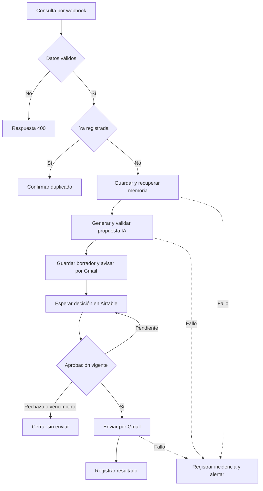

# GymPredict · Ecosistema de automatización IA

**Entrega final: gestión de consultas comerciales con memoria, propuesta personalizada y aprobación humana.**

Un cliente envía una consulta. El sistema la registra, recupera conversaciones anteriores y conocimiento comercial desde Airtable, genera una propuesta con OpenAI y avisa al responsable por Gmail. Espera una decisión humana antes de enviar la propuesta al cliente y deja registrado el resultado.

> **Estado de la entrega:** implementación y pruebas locales completadas. Los JSON están preparados para importar. La conexión de cuentas, la importación en un motor real de n8n y la demostración en vivo están pendientes. No se incluyen credenciales ni se presentan las pruebas simuladas como ejecuciones reales.

## Las cuatro tecnologías

| Tecnología | Qué hace |
|---|---|
| **n8n** | Coordina cada paso, espera la aprobación y dirige los errores. |
| **Airtable** | Guarda solicitudes, historial, información comercial y decisiones. |
| **OpenAI** | Redacta un borrador en JSON usando el contexto recuperado. |
| **Gmail** | Avisa al revisor y envía la propuesta solamente si fue aprobada. |

## Archivos principales

| Archivo | Para qué sirve |
|---|---|
| `01-leads-ia.json` | Flujo principal para importar en n8n. |
| `02-error-handler.json` | Alerta de respaldo para errores inesperados. |
| `INSTALACION.md` | Configuración paso a paso y estructura de Airtable. |
| `ARQUITECTURA.md` | Diseño, rutas, estados, seguridad y límites. |
| `VALIDACION.md` | Resultados locales y guion para la demostración real. |
| `config.example.json` | Ejemplo de configuración sin claves privadas. |
| `lead-example.json` | Consulta ficticia para probar el webhook. |
| `core.mjs` | Validación, recuperación de contexto y control de aprobación. |
| `workflow.test.mjs` | Pruebas automáticas del código y el grafo exportado. |

## Arquitectura



**HITL** significa *Human in the Loop*: una persona revisa la acción crítica. Aquí la acción es enviar una propuesta comercial. La IA no puede aprobar su propio texto.

**Memoria** significa que el sistema recupera consultas anteriores del mismo email. **Recuperación aumentada** significa que la IA recibe información comercial de la base antes de redactar. Esta implementación usa búsqueda léxica sencilla, sin embeddings ni base vectorial.

## Probar el código sin cuentas externas

Requiere Node.js 20 o superior. No tiene dependencias de terceros para construir o probar.

```sh
npm run build
npm test
npm run demo
```

`build` genera los JSON. `test` comprueba los casos funcionales. `demo` recorre el grafo con respuestas simuladas; no envía correos ni consume saldo de OpenAI.

## Activarlo con cuentas reales

1. Crear las tres tablas de Airtable siguiendo `INSTALACION.md`.
2. Importar los dos JSON en n8n y conectar Airtable, OpenAI y Gmail.
3. Completar `Configuracion` en ambos flujos y seleccionar el flujo de respaldo en los ajustes del principal.
4. Activar el principal y enviar una consulta de prueba a su URL de producción.
5. Revisar el borrador en Airtable, completar `Reviewer` y elegir `approved` o `rejected` en `Approval`.
6. Guardar evidencia real con el guion de `VALIDACION.md`.

No subir `config.local.json`, exportaciones de credenciales, registros de clientes ni tokens al repositorio. Los datos de ejemplo son ficticios. GymPredict se utiliza como caso de negocio; este proyecto no afirma una asociación con SportClub.

## Correspondencia con la consigna

| Requisito | Implementación | Verificación pendiente |
|---|---|---|
| Cuatro tecnologías | n8n, Airtable, OpenAI y Gmail | Conectar las cuentas reales |
| Disparo y proceso automático | Webhook autenticado y flujo completo | Llamada real al webhook |
| IA desde la DB | Historial y conocimiento recuperados antes del prompt | Respuesta real de OpenAI |
| Rutas de error | Validación, errores locales y workflow de respaldo | Simular una caída real en una base de prueba |
| Validación humana | Wait + decisión privada en Airtable + vencimiento | Aprobar y rechazar en vivo |
| Variables dinámicas | Datos del webhook, referencias entre nodos y configuración central | Completar configuración propia |
| Registro de salida | Estado final e ID del mensaje de Gmail | Confirmar recepción real |

## Fuentes técnicas

- [HTTP Request en n8n](https://docs.n8n.io/integrations/builtin/core-nodes/n8n-nodes-base.httprequest/)
- [Wait en n8n](https://docs.n8n.io/integrations/builtin/core-nodes/n8n-nodes-base.wait/)
- [Manejo de errores en n8n](https://docs.n8n.io/flow-logic/error-handling/)
- [Gmail en n8n](https://docs.n8n.io/integrations/builtin/app-nodes/n8n-nodes-base.gmail/message-operations/)
- [Salidas estructuradas de OpenAI](https://developers.openai.com/api/docs/guides/structured-outputs?api-mode=chat)
- [Límites de la API de Airtable](https://support.airtable.com/articles/7735693959-managing-api-call-limits-in-airtable)

Los números de versión incluidos en `typeVersion` corresponden al esquema de cada nodo exportado, no a una versión probada del servidor n8n. Verificar la compatibilidad al importar y registrar la versión usada en la evidencia.
